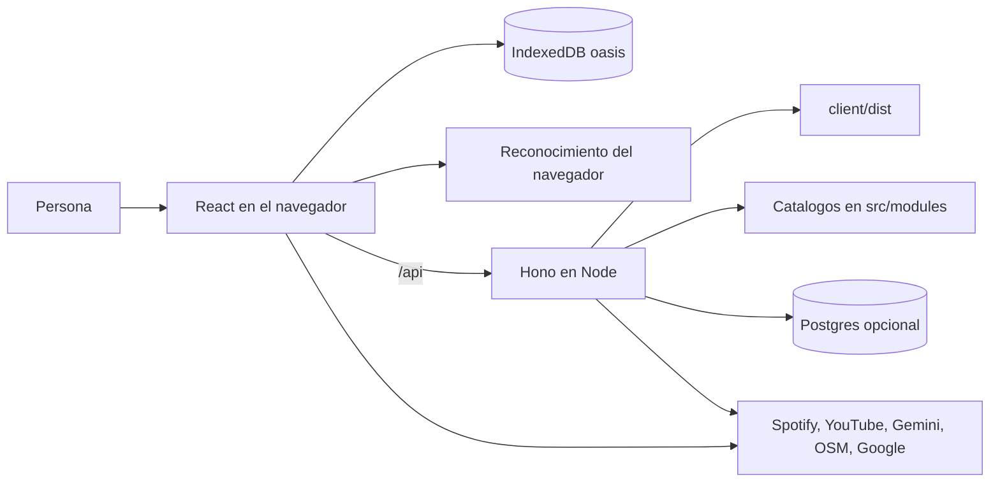

# Arquitectura

Oasis es una sola aplicación. El navegador guarda la vida personal del espacio. Node entrega la interfaz y una API de catálogos. Postgres, si está configurado, guarda solo conteos anónimos y actividades de ejemplo. No hay sesiones de servidor para la persona usuaria. La sala de colegio usa una clave aparte y un token en memoria del proceso.

## Vista

El cliente habla con el mismo origen. En desarrollo, Vite reenvía `/api` a `127.0.0.1:3000`. En producción, Hono sirve `client/dist` y responde la API.

## Cliente

`client/src/App.tsx` envuelve todo en `OasisProvider`, detecta el tipo de dispositivo y dibuja el fondo de agua. React Router distingue la visita pública de las secciones privadas.

| Pieza | Archivo | Responsabilidad |
| --- | --- | --- |
| Puerta | `modules/entrance/Entrance.tsx` | Registro, ingreso, Google y entrada sin cuenta. La isla 3D y el loto van en carga diferida. |
| Página pública | `modules/home/Landing.tsx` | Primera visita, sin sesión. |
| Shell | `modules/shell/Shell.tsx` | Barra, salida y botón de voz. Solo con sesión. |
| Inicio | `modules/home/Home.tsx` | Patio, marca del día y puertas. No repite la página pública. |
| Sala | `modules/admin/Sala.tsx` | Conteos anónimos y publicación de ejemplos. Ruta `/sala`, fuera del shell personal. |
| Cerca | `modules/nearby/Nearby.tsx` | Fichas, mapa y agenda. |
| Rincón | `modules/corner/Corner.tsx` | Diario, distracción, cápsula y marca. |
| Hablar | `modules/talk/Talk.tsx` | Fichas de llamada y pregunta al orientador. |
| Recuerdo | `modules/memory/Memory.tsx` | Conteos locales, letra y lenguaje sencillo. |
| Voz | `modules/voice/` | Web Speech API del navegador. El texto se compara en el dispositivo contra palabras fijas. |

`useDevice` elige "este computador", "esta tablet" o "este celular" para hablar de dónde viven los datos. No envía esa lectura al servidor.

La interfaz usa `prefers-reduced-motion` en la entrada para no abrir la animación del loto cuando la persona lo pide.

## Datos locales

Dexie abre la base `oasis`, versión 1, con cinco tablas:

| Tabla | Qué guarda |
| --- | --- |
| `profile` | Un solo registro, `id: "me"`. Nombre, modo de entrada, letra, lenguaje sencillo, última puerta y, si existe, la cuenta local. |
| `marks` | Una marca por día: luminoso, en calma, regular, bajito o pesado. |
| `notes` | Texto del diario y fecha. |
| `capsules` | Nota y día en que se abre. |
| `contacts` | Hasta dos personas de confianza, con nombre y teléfono. |

Los modos de entrada son `none`, `guest`, `google` y `local`. Salir pone `auth` en `none` y borra el nombre visible, pero no borra la cuenta ni el diario. `clearLocal` sí elimina la base.

La contraseña de la cuenta local no se guarda. `account.ts` deriva 256 bits con PBKDF2-SHA-256, 150000 iteraciones y una sal de 16 bytes, y compara el resultado en tiempo constante. El hash y la sal viven en IndexedDB.

## Servidor

`src/index.ts` crea la aplicación Hono, monta las rutas y escucha en `0.0.0.0` y en `PORT` (3000 si no viene definido). Después de la API, sirve `client/dist` y devuelve `index.html` para el resto de rutas, para que el enrutador del navegador funcione al recargar.

esbuild empaqueta `src/index.ts` en `dist/server.js` y deja sin empaquetar los paquetes de `node_modules`. Vite, con raíz en `client/`, escribe la interfaz en `client/dist`.

Vite resuelve el alias `@modules` a `src/modules`. Así la agenda, el archivo `.ics` y el directorio se comparten entre la interfaz y la API sin duplicar el catálogo.

## Catálogos

| Módulo | Qué decide |
| --- | --- |
| `directory/catalog.ts` | Tres fichas: Yo Te Escucho Villavicencio, Línea 106 y Línea 01 8000 931 089. Cada una trae teléfono, horario, frase para leer, fuente y fecha. |
| `orientador/match.ts` | Elige una de esas fichas por palabras de la pregunta. Por defecto, Yo Te Escucho. El límite dice que no diagnostica ni recomienda tratamientos. |
| `orientador/router.ts` | Si hay `GEMINI_API_KEY`, pide una sola frase corta. Descarta la respuesta si menciona diagnóstico, tratamiento, medicamento, dosis o suicidio, o si la llamada falla. |
| `events/catalog.ts` | `realEvents` está vacío. La agenda muestra semillas marcadas `sample: true`, con categoría distracción, bienestar o lúdicas. Una publicación de la sala se suma como ejemplo. La semana se calcula con el `today` que envía el navegador. |
| `bridge/whatsapp.ts` | Arma `https://wa.me/` en el dispositivo. No envía mensajes ni llama a la red. |
| `metrics/aggregate.ts` | Suma la semilla sintética: visitas, tonos, ayuda, distracción y agenda. |
| `metrics/store.ts` | Si hay `DATABASE_URL`, crea las tablas, siembra y lee. Si Postgres no responde, las funciones devuelven vacío o "no disponible". |
| `admin/gate.ts` | Compara `ADMIN_PASSWORD` y guarda un token en memoria. |
| `events/ics.ts` | Arma un `.ics` en el navegador. Los ejemplos llevan `[Ejemplo]` en el título. |
| `music/router.ts` | Pide a Spotify o YouTube el nombre, la portada y una URL de inserción. Si falta configuración o la llamada falla, responde una playlist vacía. |
| `playlist.ts` | Acepta un id o una URL y rechaza formas que no coinciden con el patrón de cada servicio. |

Los conteos `directory_open`, `call_click` y `help_offer` viven en memoria del proceso. No guardan identidad y vuelven a cero al reiniciar.

## API

| Método y ruta | Cuerpo o consulta | Respuesta |
| --- | --- | --- |
| `GET /api/health` | | `{ "ok": true }` |
| `GET /api/directory` | | `{ "services": ServiceCard[] }` |
| `GET /api/music/spotify` | | Playlist pública o vacía |
| `GET /api/music/youtube` | | Playlist pública o vacía |
| `POST /api/orientador` | `{ "question": string }` | `{ service, limit, intro }` |
| `GET /api/events` | | Conteos anónimos de este proceso |
| `GET /api/events/agenda` | `today=AAAA-MM-DD` | Ejemplos de esa semana, más actividades de Postgres si la base responde |
| `POST /api/events` | `{ "type": "visit" \| "mood" \| "help" \| "distraction" \| "agenda" \| "directory_open" \| "call_click" \| "help_offer", "tone"? }` | `{ "ok": true }` o 400. El tono solo se acepta si es uno de los cinco de la marca |
| `GET /api/metrics/semilla` | | Agregado sintético, sin base |
| `POST /api/admin/entrar` | `{ "password" }` | Token o 401. 503 si falta `ADMIN_PASSWORD` |
| `GET /api/admin/resumen` | `Authorization: Bearer` | Agregado de Postgres, o estado no disponible |
| `POST /api/admin/actividades` | Borrador de actividad y token | La guarda como ejemplo, o 503 si no hay base |

Ninguna ruta exige sesión. La sesión solo existe en el navegador y decide qué pantallas enseña React Router.

## Construcción

| Comando | Efecto |
| --- | --- |
| `npm run dev` | API con `tsx`, recarga al guardar el servidor. |
| `npm run dev:web` | Vite. El proxy de `/api` apunta a `127.0.0.1:3000`. |
| `npm run build` | `client/dist` más `dist/server.js`. |
| `npm start` | `node dist/server.js`. |
| `npm test` | Playlists, agenda, filtros, orientador, WhatsApp, semilla de métricas y voz. Postgres se omite sin `DATABASE_URL`. |

El service worker de Workbox precachea estáticos y usa `index.html` como respaldo de navegación. Los HTML y el propio service worker se sirven con `Cache-Control: no-cache` para que un deploy nuevo pueda reemplazarlos.

## Contenedor

El `Dockerfile` tiene dos etapas sobre `node:22-bookworm-slim`.

1. La etapa `builder` instala con `npm ci`, compila y poda las dependencias de desarrollo.
2. La etapa `runner` se queda con `package.json`, `node_modules`, `dist/server.js` y `client/dist`. Crea el usuario de sistema `oasis` y arranca con `node dist/server.js`, que es el proceso principal y recibe las señales del orquestador.

`VITE_GOOGLE_CLIENT_ID` es un argumento de build porque queda dentro del paquete del navegador. El resto de llaves son variables de entorno del contenedor en marcha. `.dockerignore` deja fuera `node_modules`, artefactos, `.env` y esta documentación.

`docker-compose.yml` publica el puerto 3000, levanta Postgres 16 solo en `127.0.0.1:5432`, fija `PORT=3000` y `DATABASE_URL` dentro de la red del compose, y reenvía `ADMIN_PASSWORD` si existe en el entorno. Oasis no espera a que Postgres esté sano para arrancar: si la base falta, el espacio personal sigue.

## Render

El servicio `oasis` del workspace de Mariana despliega la rama `main` con runtime Node, `npm install && npm run build` y `npm start`. La URL pública es `https://oasis-hiu0.onrender.com`. El plan gratuito se duerme tras un rato sin visitas. El disco de Render es efímero: los conteos en memoria no sobreviven a un deploy o a un reinicio, y eso coincide con el diseño, porque no son un registro personal.

## Decisiones

- Una cuenta por navegador. No hay registro de muchas personas en un servidor.
- El directorio es una lista cerrada con fuente y fecha, no un buscador de lugares.
- La agenda prefiere mostrar ejemplos rotulados antes que inventar actividades.
- El orientador elige primero por reglas y solo entonces, si hay llave, pide una frase. La frase no sustituye a la ficha oficial.
- La voz no tiene un modelo propio. Si el navegador no ofrece reconocimiento, el botón no aparece.
